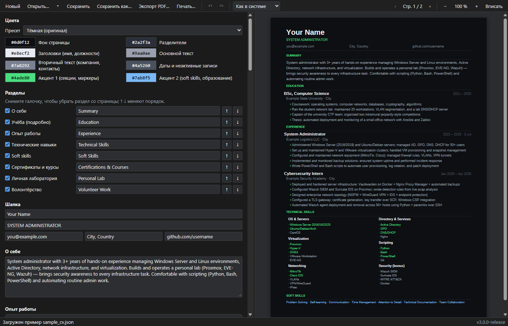
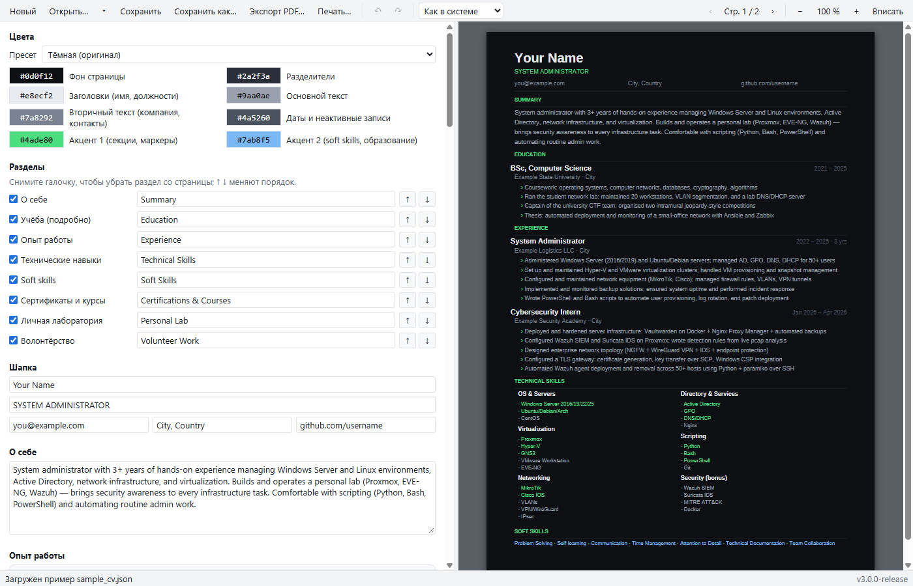

# CV Builder

Десктопное приложение: слева форма редактирования резюме, справа живой
предпросмотр, на выходе — A4-PDF по тёмному шаблону. Данные хранятся в JSON,
так что можно держать несколько версий резюме.

Начиная с версии 3.0 приложение написано на [Tauri 2](https://tauri.app):
бэкенд на Rust, интерфейс на TypeScript без UI-фреймворка. Ядро — свой парсер
JSON, свой парсер и сабсеттер TrueType, свой движок раскладки и свой генератор
PDF — перенесено с C++ построчно и выдаёт **те же байты**: каждое резюме из
`fixtures/` экспортируется в тот же PDF, что и в версии 2.x (см. «Шрифт и
одинаковый PDF»).

## Платформы

| | Сборка | Состояние |
| --- | --- | --- |
| Windows 10/11 | NSIS-установщик, `cvcli.exe` | собирается и проверена (`npm run release`) |
| Linux x86-64 | `.deb`, AppImage, отдельный `cvcli` | ядро платформенно-независимо; сборку приложения на Linux ещё нужно прогнать — см. «Что осталось» |
| macOS | — | Tauri её поддерживает, но бандл не настроен и не собирался |

## Как это выглядит

Тёмная и светлая палитра интерфейса — слева форма, справа страница A4:





## Возможности

- Редактируются все секции шаблона: шапка и контакты, «о себе», опыт работы
  (должности с пунктами), технические навыки (группы в две колонки, у каждого
  навыка флаг выделения), soft skills, учёба, сертификаты и курсы,
  волонтёрство, личная лаборатория.
- Полный контроль цвета: 8 ролей (фон, разделители, заголовки, текст,
  вторичный текст, приглушённый текст, акцент 1, акцент 2) через выбор цвета,
  плюс 11 готовых пресетов. Палитра хранится вместе с резюме.
- Добавление, удаление и перестановка работ, пунктов, навыков, групп и записей.
- Настраиваемый состав документа: любой раздел можно переименовать, отключить
  или подвинуть вверх-вниз в блоке «Разделы». Порядок хранится в резюме
  (ключ `sections`); файлы без него читаются как раньше и получают порядок по
  умолчанию.
- Живой предпросмотр с зумом 50–300 % (`Ctrl` + колесо, `Ctrl+=`/`Ctrl+−`),
  «Вписать» и навигацией по страницам; перенос на вторую страницу происходит
  автоматически.
- Сохранение и загрузка JSON (`Ctrl+S` / `Ctrl+Shift+S` / `Ctrl+O`), экспорт PDF
  (`Ctrl+E`) — готовый файл сразу открывается в системном просмотрщике. Печать
  (`Ctrl+P`) — через системный диалог, где выбирается и диапазон страниц.
- Отмена и возврат (`Ctrl+Z`, `Ctrl+Y` / `Ctrl+Shift+Z`) — 50 шагов.
- Список недавних файлов под стрелкой у кнопки «Открыть…».
- Файл резюме можно просто перетащить на окно — он откроется так же, как
  через `Ctrl+O`, с тем же вопросом о несохранённых изменениях. Если
  перетащить несколько файлов, откроется первый, а в строке состояния будет
  сказано, сколько их было. Запуск второй копии с файлом открывает его в уже
  открытом окне.
- Светлая и тёмная темы интерфейса: «Как в системе», «Светлая», «Тёмная». В
  первом режиме окно следует системной настройке и перекрашивается сразу, как
  её меняют.
- Полная поддержка кириллицы: шрифт внедряется в PDF подмножеством — вместе с
  картой ToUnicode, поэтому из PDF корректно копируется текст.
- Восстановление после сбоя: пока есть несохранённые изменения, раз в полминуты
  пишется снимок; если сеанс закончился аварийно, при следующем запуске
  предлагается его восстановить. Снимок старше файла, из которого он сделан,
  считается устаревшим и удаляется, а не предлагается.

Настройки (тема, недавние файлы) и снимок восстановления лежат в каталоге
данных приложения (`%APPDATA%\io.github.cvbuilder` на Windows,
`~/.local/share/io.github.cvbuilder` на Linux) в виде `settings.json` и
`autosave.json`. При первом запуске 3.x тема и недавние файлы версии 2.x
переносятся оттуда, где та их хранила (реестр `HKCU\Software\CV Builder` или
`settings.ini`), — один раз и только на чтение.

## Шрифт и одинаковый PDF

Переносы строк в шаблоне — функция ширин символов того шрифта, которым резюме
размечено. Поэтому шрифт (Liberation Sans, SIL OFL 1.1) вшит в программу и
используется всегда: PDF, собранный на любой системе, — один и тот же файл, а
резюме, размеченное в одной версии, не «поедет» в другой. Почему именно этот
шрифт и как это проверить — в [`assets/fonts/README.md`](assets/fonts/README.md).

Предпросмотр не просит браузер раскладывать текст: каждый символ ставится в ту
точку, которую посчитал движок раскладки по ширинам того же шрифта, а сам шрифт
страница загружает из тех же файлов. Поэтому экран, печать и PDF не могут
разойтись в переносах.

Перенос с C++ проверен против эталонов, снятых с последней C++-сборки
(`fixtures/`): сохранённый JSON, раскладка до последнего бита каждой
координаты, байты PDF, вывод `cvcli`. Закреплённый хеш PDF из старых тестов
(`7410097b186e6353`) не изменился.

## Сборка

Нужны Rust (stable, 1.90+) и Node.js. На Windows — ещё Visual Studio Build Tools
(MSVC) и WebView2 (в Windows 11 есть всегда). На Linux — зависимости Tauri:

```bash
sudo apt install build-essential libwebkit2gtk-4.1-dev libxdo-dev libssl-dev \
                 libayatana-appindicator3-dev librsvg2-dev
```

Дальше:

```bash
npm ci
npm run tauri dev           # запуск с пересборкой при изменениях
cargo test --workspace      # тесты Rust
npx tsc --noEmit            # проверка типов страницы
npm run tauri build         # сборка без cvcli в установщике
```

## Выпуск

```bash
npm run release
```

Скрипт (`scripts/release.mjs`) прогоняет тесты, собирает `cvcli` и приложение с
`--remap-path-prefix` для всех локальных путей, проверяет, что в исполняемых
файлах не осталось ни пути сборки, ни имени пользователя, и кладёт в
`releases/<версия>/` установщик (или `.deb` и AppImage на Linux), отдельный
`cvcli` и `SHA256SUMS.txt`.

Версия задаётся в `Cargo.toml` (`[workspace.package] version`) и в
`package.json`; скрипт проверяет, что они совпадают. Подпись в правом нижнем
углу окна — `v3.0.0-release` — собирается из версии и канала
(`crates/cvb-core/src/about.rs`).

## Установщик

NSIS-установщик ставит программу для себя (`%LOCALAPPDATA%`, без прав
администратора) или для всех пользователей (`Program Files`) — выбор на первом
шаге. Рядом с приложением кладётся `cvcli.exe`. В конце установки он спрашивает,
добавить ли папку программы в PATH, чтобы `cvcli` вызывался из любой консоли по
имени: «Да» добавляет каталог один раз, «Нет» убирает запись, оставленную
прошлой установкой, деинсталлятор убирает её тоже. Остальное содержимое `PATH`
не трогается. Если WebView2 в системе нет, установщик ставит его сам.

## Иконка

Иконка генерируется из палитры шаблона:

```bash
python tools/make_icon.py              # src-tauri/icons/icon.ico
python tools/make_icon.py --png 1024   # src-tauri/icons/source.png
npx tauri icon src-tauri/icons/source.png -o src-tauri/icons
```

После `tauri icon` нужно снова запустить первую команду: в `.ico` малые размеры
рисуются упрощённо, и он пишется отдельно.

## Консольный рендерер

`cvcli` рендерит JSON в PDF без графического интерфейса — удобно для скриптов и
для проверки раскладки:

```
cvcli sample_cv.json out.pdf
cvcli sample_cv.json out.pdf --dump-ops ops.json
cvcli sample_cv.json out.pdf --fonts regular.ttf bold.ttf
cvcli --font-report [--fonts regular.ttf bold.ttf]
cvcli --version
```

`--dump-ops` выгружает полный список примитивов отрисовки (каждая строка текста
с координатами, размером и цветом), `--fonts` задаёт пару начертаний явно,
`--font-report` печатает ширину каждого символа, который может поставить
шаблон, `--version` — ту же строку, что видна в углу окна. `cvcli` собирается
только из ядра и от webkit не зависит.

## Структура

| Путь | Назначение |
| --- | --- |
| `crates/cvb-core/` | Ядро без ОС и интерфейса: `json`, `numfmt`, `model`, `font`, `layout`, `pdf`, `about` |
| `crates/cvcli/` | Консольный рендерер |
| `src-tauri/src/lib.rs` | Плагины, single-instance, общее состояние, все команды в одном `generate_handler!` |
| `src-tauri/src/commands.rs` | Тонкие обёртки команд |
| `src-tauri/src/document.rs` | Новый / открыть / сохранить / экспорт, запуск и закрытие |
| `src-tauri/src/files.rs` | Проверка путей, чтение с лимитом, атомарная запись |
| `src-tauri/src/settings.rs`, `recent.rs`, `recovery.rs`, `session.rs` | Настройки, недавние файлы, снимок восстановления, состояние документа |
| `src-tauri/src/preview.rs` | Раскладка в виде, удобном для SVG |
| `src-tauri/src/dialogs.rs` | Нативные диалоги |
| `src-tauri/src/error.rs` | Единый тип ошибки с `kind` |
| `src/api.ts` | Единственное место с `invoke()` и TS-типы структур Rust |
| `src/dom.ts` | Построение DOM через `createElement` |
| `src/main.ts` | Сборка окна, таймеры, клавиатура |
| `src/editor/` | Форма редактора |
| `src/preview.ts`, `print.ts`, `toolbar.ts`, `statusbar.ts`, `error-dialog.ts` | Предпросмотр, печать, панель, строка состояния, диалог ошибки |
| `fixtures/` | Эталонный вывод C++-версии, против которого проверяется Rust |
| `scripts/release.mjs` | Выпуск |
| `src-tauri/installer/hooks.nsh` | PATH в установщике |

## Безопасность

- Строгий CSP без `unsafe-eval` и inline-скриптов; прототипы заморожены.
- Страница не получает ни доступа к файловой системе, ни диалогов, ни запуска
  программ: в capabilities только её собственные команды и подписка на события.
  Пути выбираются в Rust — в нативных диалогах, по индексу в списке недавних,
  из события перетаскивания — и до страницы не доходят.
- Всё, что приходит снаружи, проверяется в Rust: пути (абсолютные, без `..`),
  размер файлов, глубина JSON, шрифты (битый шрифт — ошибка, а не падение),
  резюме со страницы. На каждую проверку есть отдельный тест.
- Запись всегда атомарная: временный файл рядом и переименование.
- Нет ни телеметрии, ни сетевых запросов, ни автообновления.
- Release: LTO, `panic = "abort"`, strip; на Windows — Control Flow Guard и
  `/PDBALTPATH`. Раз в месяц `.github/workflows/audit.yml` прогоняет
  `cargo audit` и `npm audit`.

## Что осталось

- **Linux-сборка приложения не прогонялась.** Ядро и `cvcli` от платформы не
  зависят и проверены эталонами, но окно на webkit2gtk, `.deb` и AppImage нужно
  собрать на Linux (`npm run release`) и посмотреть.
- **macOS** не настроена и не собиралась.
- Многостраничный предпросмотр показывает одну страницу за раз, как и раньше.
